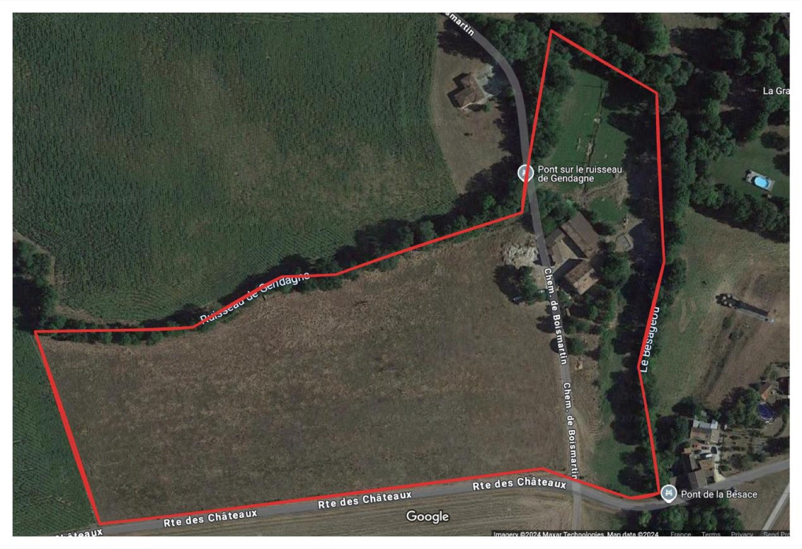
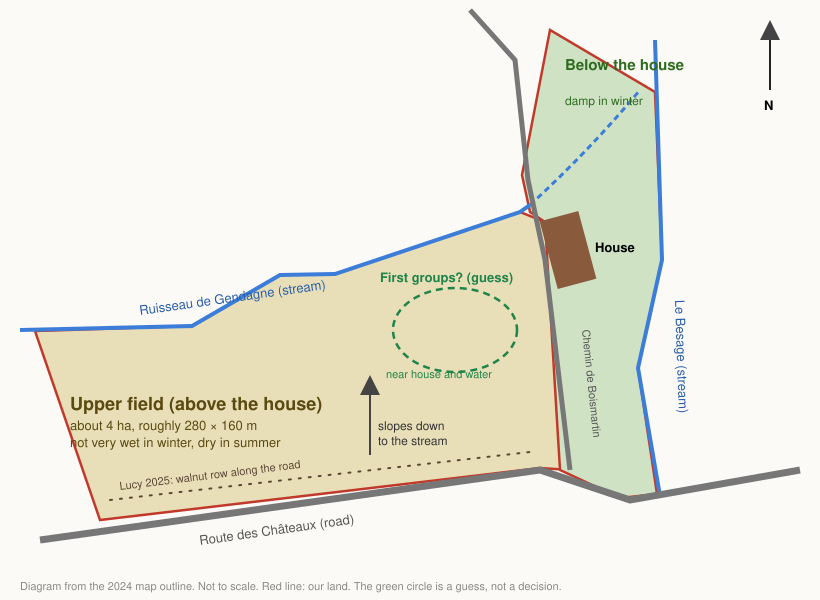
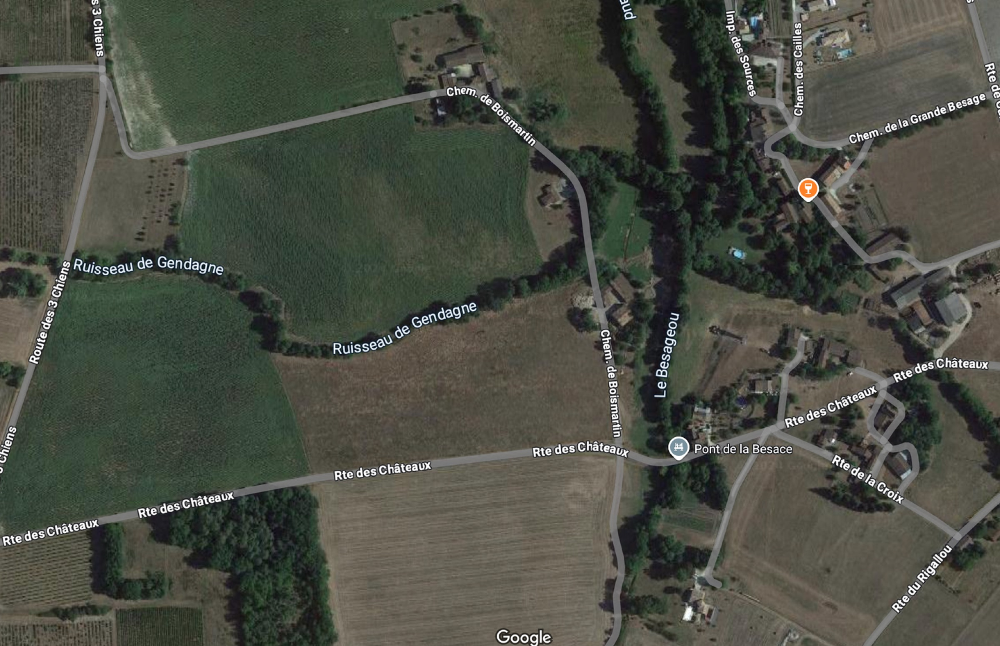
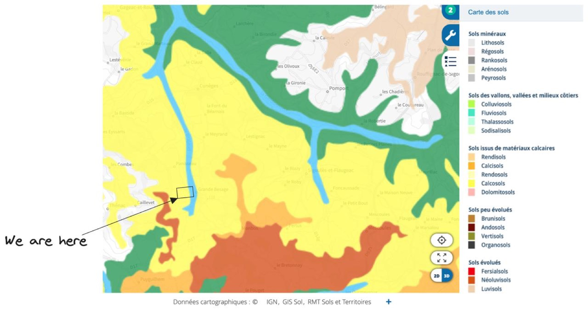

<!-- Synced from private notes on 2026-11-25. Edit there first. -->

An overview of the land at the Life Itself Farmhouse, for anyone helping with projects on it, such as the [fruit tree planting](/hubs/farmhouse/trees). Part of the [Farmhouse knowledge base](/hubs/farmhouse/kb).

## Where it is

The land sits at the bottom of a hill, next to a small hamlet near Thénac in the Dordogne, a few kilometres from Plum Village.

A simple diagram of the same. It is not to scale, and the green circle is a guess at where the first trees could go, not a decision.

The land is bounded by the Route des Châteaux to the south, the Ruisseau de Gendagne (a stream) to the north, and the Besage stream and the Chemin de Boismartin on the east side, around the house.

## The two fields

* **Upper field** (about 4 ha): the big field between the road and the stream, west of the house. It slopes gently down towards the stream on the north side. It does not get very wet in winter, but it is dry in summer. This is where we plan to plant the fruit trees.
* **Lower field**: below the house, by the Besage. It is quite wet and damp in winter.

Drone flyovers:

* [Upper field](https://www.youtube.com/watch?v=2rp3pX0j2pY)
* [Lower field](https://www.youtube.com/watch?v=u2PN2PkF-YA)
* [Around the house](https://www.youtube.com/watch?v=-71hq4XKMmk)

## Soil

The national soil map ([Géoportail, carte des sols](https://www.geoportail.gouv.fr/donnees/carte-des-sols)) shows **calcosols** on the upper field and **fluviosols** (river soils) on the lower field.

A 2020 lab analysis of the upper field found a good clay loam that is alkaline but has little free chalk. More on the [soil page](/hubs/farmhouse/soil).

## Water

* We have ideas for where a pond could go, and asked the local authorities for permission for one in autumn 2024.
* Swales and berms along the contour were suggested in 2025, to stop trees getting waterlogged in winter and to store water for the summer. They are on hold for now: see the [tree planting plan](/hubs/farmhouse/trees/plan).

## Principles (2024)

* Minimal effort, until there is someone whose passion this is.
* Trees first, because they are long-term and fairly low maintenance.
