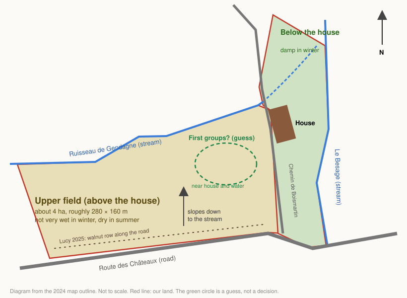

<!-- Synced from private notes on 2026-11-25. Edit there first. -->

  
Status, 25 November 2026

  
Order due with a local organic nursery this week. We plan to collect the trees on 28 November (to be confirmed) and plant in the first two weeks of December.

We are planting about twenty organic, bare-root fruit and nut trees on the big field above the [Life Itself Farmhouse](/hubs/farmhouse) near Thénac, in the Dordogne. Plums, local apples, quince, medlar, figs and walnuts, with a few shrubs to shelter them and feed the soil.

This is our second try. In the winter of 2024/25 we did most of the groundwork, but nothing was planted (see [what happened](/hubs/farmhouse/trees/history)). This time the plan is smaller and the dates are fixed.

Not to scale. The green circle is a guess at where the first trees could go, not a decision.

## Why

* Trees first, because they are long-term and fairly low maintenance.
* Plums do very well here, apples do well and walnuts are common in the region. A small orchard of local varieties should give fruit for the people who live and stay at the Farmhouse, and for neighbours.
* A small first planting teaches us what survives deer and the first dry summer before we plant more.

## What done looks like

By Christmas 2026:

* the trees are decided, ordered and in the ground (by about 13 December);
* each tree or group is protected from deer;
* the people on site know what to check and water through the winter and spring.

## Pages

* [The plan](/hubs/farmhouse/trees/plan): what, where and how. Still a plan until it is in the ground.
* [History](/hubs/farmhouse/trees/history): the 2024/25 attempt and why it stalled.
* [Updates](/hubs/farmhouse/trees/updates): dated news, newest first.
* About the place: [the land](/hubs/farmhouse/land) and [the soil](/hubs/farmhouse/soil).

## Want to help?

Come and plant in early December, or help look after young trees through the spring. We will post planting dates on [Updates](/hubs/farmhouse/trees/updates). [Get in touch](/contact) if you would like to come.
