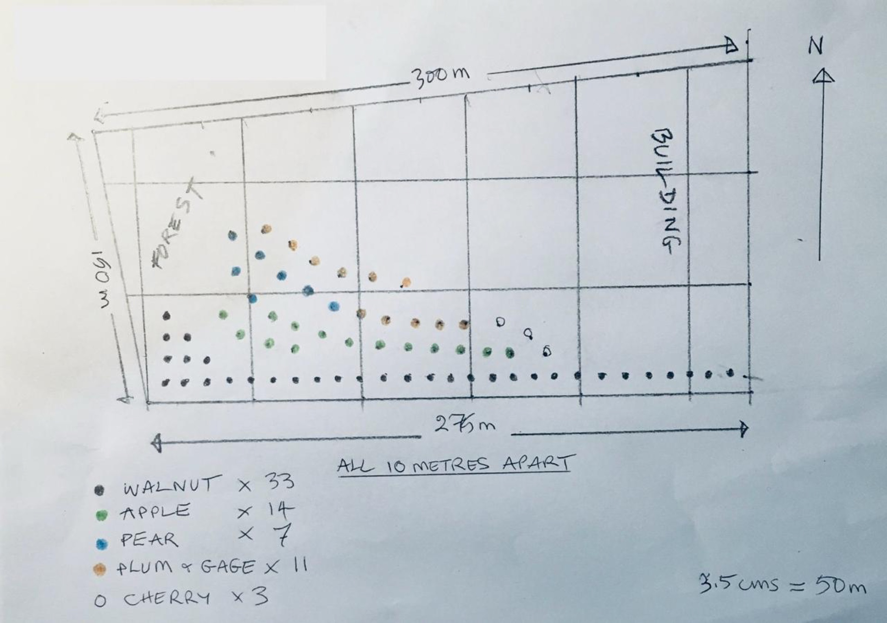

<!-- Synced from private notes on 2026-11-25. Edit there first. -->

A short history of our first try at planting trees at the Farmhouse, from November 2024 to February 2025. Part of [fruit tree planting at the Farmhouse](/hubs/farmhouse/trees).

## Timeline

* **Mid-November 2024:** Rufus asks the wider Life Itself network for advice on tree planting and permaculture.
* **22 November 2024:** a planting group starts. Lucy, who studied permaculture with Bill Mollison, sets out the first steps: find out about the soil and the rock underneath, test the pH in several places, and observe the land first. Jo, an experienced grower who knows which varieties suit which soils, will visit at Christmas.
* **25 November 2024:** first visit to the land with Lucy. Next steps: get manure, put down cardboard and manure, look for trees, sketch a design.
* **Early December 2024:** drone videos of the land. Lucy reads the soil report. Plan: buy trees at the turn of the year and plant in mid-January.
* **23 January 2025:** Lucy's first draft planting plan, with 68 trees. Planting moves to mid-February.
* **28 January 2025:** planning session with Lucy and Jo; a variety list is shared. Aim: 50–100 trees in mid-February, with a planting festival.
* **Late January to early February 2025:** feedback from friends on layout, shade, walnut roots, and berms and swales. Lucy suggests either leaving room for swales or spending a year on earthworks first. Rufus: plant a few this year as an experiment.
* **14 February 2025:** donkey manure delivered.
* **24 February 2025:** spring is coming and no trees have been bought. Rufus asks for someone to come and look after the land. Nothing more happens.
* **22 November 2026:** planting is back on. See [updates](/hubs/farmhouse/trees/updates).

## The 2025 plan

* The upper field, with 68 trees 10 m apart:
  * 33 walnuts in a long row along the road and a block at the west end;
  * 14 apples and 7 pears in the middle;
  * 11 plums and gages in the top row, nearest the stream;
  * 3 cherries at the east end.
* Forest trees (chestnut, oak, birch) at the west end.
* Walnuts on the south side because the ground is higher there, the sun is high in summer, and it leaves the north side free for vegetables and swales later.

This year's plan starts from it, but is much smaller: see [the plan](/hubs/farmhouse/trees/plan).

## What we gained

* Detailed knowledge of the land and what to do with it.
* A clear plan and a variety list, thanks especially to Jo.
* Permission sought for a pond.
* Good local contacts.

## Why nothing was planted

* The dates slipped from mid-January to mid-February, waiting on the plan, the manure and the variety list.
* The idea of berms and swales arrived late, and raised the question of doing earthworks first.
* Nobody was on site with the time and interest to drive it.

What we take from it: order early, keep the first planting small, and have one person who owns it.

## Advice we were given

* Courses: [Applewood Permaculture](https://applewoodcourses.com) (UK) and the [Permaculture Education Institute](https://permacultureeducationinstitute.org).
* Projects to learn from: [The Biggest Mini Forest](https://www.biggestminiforest.com/) (Portugal) and [L'Onda Fertile](https://www.ondafertile.com/) (Puglia).
* Book: Patrick Whitefield, *The Earth Care Manual*.
