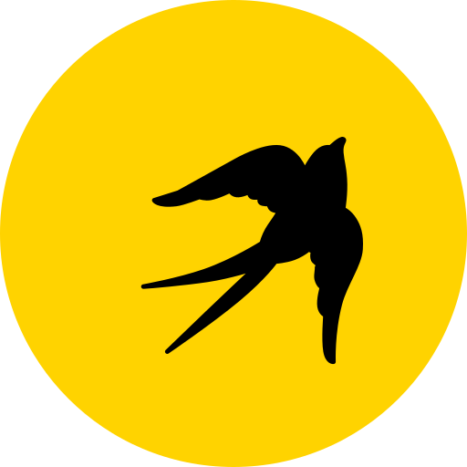
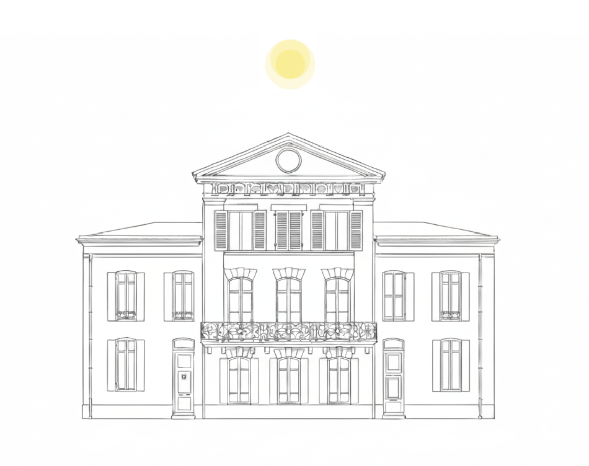
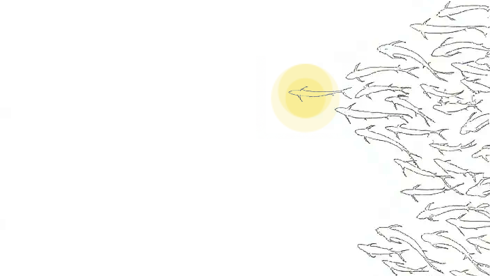
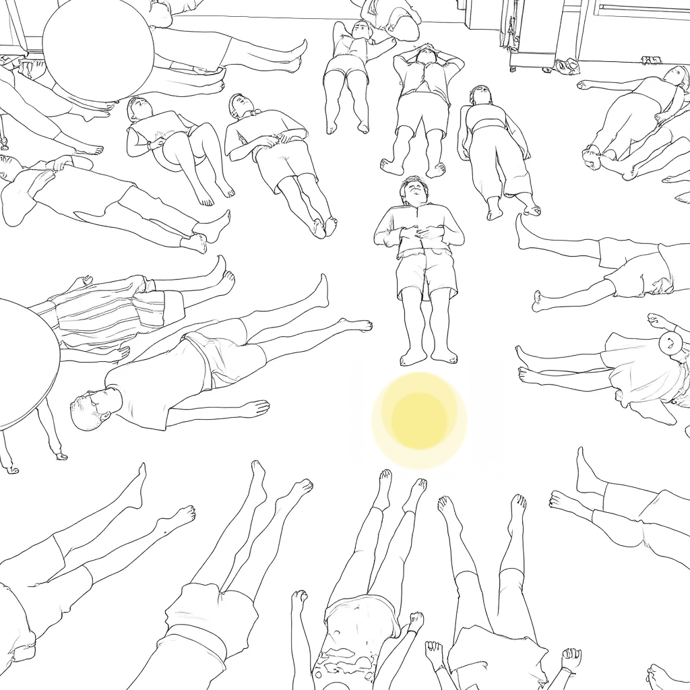
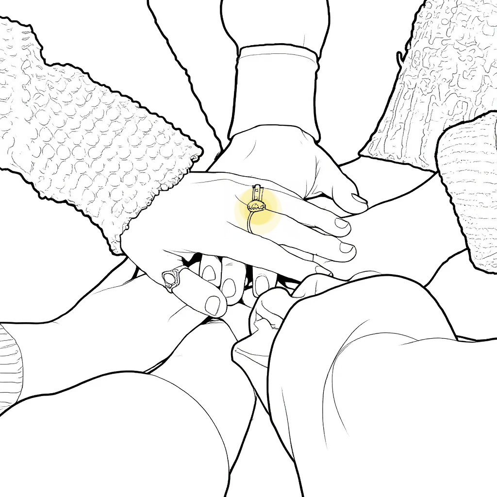

    
<main class="flex-1">
<section
  class="relative isolate flex min-h-[90vh] items-center justify-center overflow-hidden bg-black text-white"
>
  <video
    class="absolute inset-0 h-full w-full object-cover"
    src="https://assets.lifeitself.org/lifeitself.org/videos/homepage/homepage-hero.v1.mp4"
    poster="/assets/images/homepage-poster.png"
    autoplay
    muted
    loop
    playsinline
  ></video>
  

  

    
    <h1
        class="font-restora text-4xl font-bold leading-tight sm:text-5xl"
    >
        Pioneering Civilizational Renewal
    </h1>
    

        Life Itself is a living experiment in wise living
        and wise societies, where inner transformation,
        systemic change, and cultural renewal converge.
    

    

        <a
            href="#introduction"
            class="rounded-full bg-[#ffd300] px-6 py-3 text-sm font-semibold uppercase tracking-wide text-black shadow hover:bg-[#e6be00]"
        >
            Learn More
        </a>
    

    <form method="post" action="https://mailer.lifeitself.org/newsletter/v1" class="li-newsletter li-newsletter--hero" aria-label="Life Itself newsletter signup">
      <label for="hero-newsletter-email" class="li-newsletter-label">Stay connected with Life Itself</label>
      

        <input id="hero-newsletter-email" type="email" name="email" autocomplete="email" placeholder="Enter your email" required />
        <button type="submit">Subscribe</button>
      

      <input type="hidden" name="target" value="life-itself" />
      <input type="hidden" name="redirect" value="https://lifeitself.org/newsletter/thanks" />
      
Send me the Life Itself newsletter. Unsubscribe at any time. <a href="/privacy-policy">Privacy policy</a>

    </form>
  

</section>

<section
    id="introduction"
    class="mx-auto w-full max-w-5xl px-6 py-24 text-center"
>
    

        What We Do
    

    <h2 class="mt-4 font-restora text-4xl font-semibold">
        Our Four Pathways
    </h2>
    

        We create the conditions for transformation: personal,
        cultural, and systemic. Through living systems, learning
        experiences, research, and collaboration, Life Itself is
        cultivating prototypes for a regenerative future.
    

</section>

<section class="space-y-24 bg-white px-6 py-10">
    <article
        class="mx-auto flex w-full max-w-6xl flex-col gap-10 md:grid md:grid-cols-2 md:items-center"
    >
        

            <h3 class="font-restora text-3xl font-semibold">
                Hubs &amp; Developmental Spaces
            </h3>
            

                Where conscious living becomes practice.
            

            

                Intentional communities and residencies, once in
                Berlin and London, now nestled in the south of
                France, invite immersion into co-living and
                experimentation. Lasting change grows in places
                where people truly meet, where curiosity becomes
                belonging, and shared purpose becomes practice.
            

            <a
                href="/hubs/"
                class="inline-flex rounded-full bg-[#ffd300] px-5 py-2 text-sm font-semibold uppercase tracking-wide text-black shadow hover:bg-[#e6be00]"
            >
                Explore the Hubs
            </a>
        

        

            
        

    </article>
    <article
        class="mx-auto flex w-full max-w-6xl flex-col gap-10 md:grid md:grid-cols-2 md:items-center"
    >
        

            
        

        

            <h3 class="font-restora text-3xl font-semibold">
                Research &amp; Inquiry
            </h3>
            

                Exploring the questions that shape the Second
                Renaissance.
            

            

                Collaborative circles probing culture, systems,
                and transformation with humility and depth: a
                collective action of exploration at the edges of
                systems thinking, culture, and imagination. Amid
                a growing field of sense-making, we build
                partnerships, convene thoughtful dialogue, and
                publish work that orients both newcomers and
                seasoned explorers.
            

            <a
                href="https://lifeitselfresearch.substack.com/"
                class="inline-flex rounded-full bg-[#ffd300] px-5 py-2 text-sm font-semibold uppercase tracking-wide text-black shadow hover:bg-[#e6be00]"
                target="_blank"
                rel="noreferrer"
            >
                Explore Research Collective
            </a>
        

    </article>
    <article
        class="mx-auto flex w-full max-w-6xl flex-col gap-10 md:grid md:grid-cols-2 md:items-center"
    >
        

            <h3 class="font-restora text-3xl font-semibold">
                Learning &amp; Practice
            </h3>
            

                A hopeful future depends on the quality of our
                inner lives.
            

            

                Our awareness, our relationships, our capacity
                to grow. We co-design courses, retreats, and
                learning journeys that support multiple
                dimensions of inner development and weave them
                directly into efforts for systemic and social
                change. From embodiment retreats to
                developmental programs, we bridge inner work
                with collective action.
            

            <a
                href="https://praxishub.substack.com/"
                class="inline-flex rounded-full bg-[#ffd300] px-5 py-2 text-sm font-semibold uppercase tracking-wide text-black shadow hover:bg-[#e6be00]"
                target="_blank"
                rel="noreferrer"
            >
                Explore Learning Journeys
            </a>
        

        

            
        

    </article>
    <article
        class="mx-auto flex w-full max-w-6xl flex-col gap-10 md:grid md:grid-cols-2 md:items-center"
    >
        

            
        

        

            <h3 class="font-restora text-3xl font-semibold">
                Movement &amp; Collaboration
            </h3>
            

                Connecting seekers, artists, and system-thinkers
                daring new ways of being.
            

            

                Across the world, creative and courageous people
                are carrying the threads of new-paradigm
                thinking and practice. We work to strengthen
                this emerging fabric, building partnerships
                across disciplines, and connecting thinkers,
                artists, communities, and organisations
                exploring post-conventional ways of life.
            

            <a
                href="/get-involved"
                class="inline-flex rounded-full bg-[#ffd300] px-5 py-2 text-sm font-semibold uppercase tracking-wide text-black shadow hover:bg-[#e6be00]"
            >
                Partner With Us
            </a>
        

    </article>
</section>

<section class="mx-auto my-24 w-full max-w-5xl px-6">
    

        <video
            class="h-full w-full object-cover"
            src="https://assets.lifeitself.org/lifeitself.org/videos/homepage/quote-landing-1.v1.mp4"
            autoplay
            muted
            loop
            playsinline
        ></video>
    

</section>

<section class="mx-auto w-full max-w-4xl px-6 text-center">
    <h2 class="font-restora text-4xl font-semibold">
        Why Are We Here?
    </h2>
    

        We are living through an era of profound transition, one
        marked by cascading crises, but also by the possibility
        of renewal. The systems that shaped the modern world are
        fracturing in ways that can no longer be repaired. What
        we face is not only ecological or political, but a
        metacrisis: a crisis of meaning, imagination, and
        worldview.
    

    

        At this threshold, Life Itself works to give form and
        voice to a hopeful new cultural paradigm, one rooted in
        wisdom, regeneration, and deeper relationship with life.
        Whether this age is remembered for collapse or for
        renewal depends on our willingness to transform, now. To
        cultivate a Second Renaissance requires ways of being
        and seeing that stretch beyond the modern imagination.
    

</section>

<section class="mx-auto my-24 w-full max-w-5xl px-6" aria-labelledby="theory-of-change">
  

    <h2 id="theory-of-change" class="font-restora text-4xl font-semibold">Narrative &amp; Theory of Change</h2>
    
Life Itself is dedicated to catalyzing a deep transformation in culture and society; one that enables new horizons of human and ecological flourishing. Our aim is to foster conditions in which all life can thrive, and in which we collectively develop the capacity to meet, and ultimately transcend, the ecological, social, and spiritual crises of our time.

    
The short narrative and theory of change below trace the path from our core conviction, that profound yet practical shifts are urgently required, to the concrete actions we are undertaking to bring this transformation into being.

  

  

    

      <h3 class="font-restora text-2xl font-semibold leading-snug">1. Aim: a paradigmatic civilizational transition, a “Second Renaissance” and the birth of an awakening society</h3>
      <ul class="mt-4 list-disc space-y-1 pl-5 text-neutral-600">
        <li>On the scale of the last transition, from medieval to modern.</li>
      </ul>
    

    

    

      

      

        <h3 class="font-restora text-2xl font-semibold leading-snug">2. How do such transitions come about?</h3>
        <ul class="mt-4 list-disc space-y-1 pl-5 text-neutral-600">
          <li>A new cultural and societal model starts existing in <strong class="text-neutral-900">pockets</strong>, within and alongside mainstream culture.</li>
          <li>Experimental and evolutionary: even in its end state there is likely much variation.</li>
          <li>Like water coming to the boil: bubbles form first, then the whole pot turns.</li>
        </ul>
      

      <aside class="rounded-2xl border border-dashed border-neutral-400 bg-neutral-50 p-5 text-sm text-neutral-600">
        
Where are we in the transition?

        
Early on. Birth. Some precursors and few, if any, major pockets formed.

      </aside>
    

    

    
How we support this transition

    <svg class="hidden h-14 w-full max-w-2xl md:block" viewBox="0 0 600 56" fill="none" preserveAspectRatio="none" aria-hidden="true">
      <path d="M300 0 C300 30 150 20 150 56 M300 0 C300 30 450 20 450 56" stroke="#a3a3a3" stroke-width="2" vector-effect="non-scaling-stroke"/>
    </svg>
    

    

      

        <h3 class="font-restora text-2xl font-semibold leading-snug">Create “Pockets” of a Second Renaissance</h3>
        
Support the formation, sustenance, growth and connection of pockets that are pioneering the future paradigm, culturally and economically.

      

      

        <h3 class="font-restora text-2xl font-semibold leading-snug">Build a “Movement” for a Second Renaissance</h3>
        
Engage mainstream culture first to “heat the water” (so more individuals transition, and the environment becomes more hospitable to pockets) and ultimately build a broad-based movement for a Second Renaissance.

      

    

    

    
To support that …

    

    

      
Sangha for a Second Renaissance

      
Within that … a Shambhala Warrior Sangha

    

    

    

      

        <h4 class="font-restora text-xl font-semibold">Hubs</h4>
        
Physical pockets, or hubs for pockets: a meeting place, a starting point.

      

      

        <h4 class="font-restora text-xl font-semibold">Greenhouse</h4>
        
Support or incubate nascent initiatives, be they living spaces, enterprises or hubs.

      

      

        <h4 class="font-restora text-xl font-semibold">Lighthouse</h4>
        
Create beacons so people can find the pockets and the ideas.

      

    

    

    
Supporting all of this …

    

    

      <h4 class="font-restora text-xl font-semibold">Research</h4>
    

  

</section>
</main>
